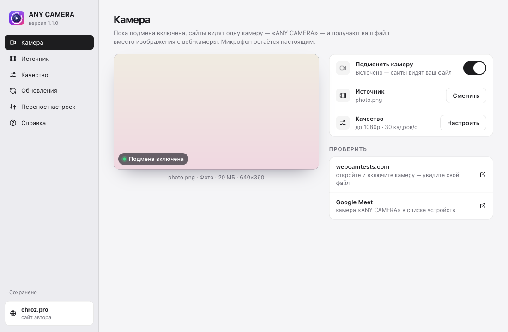
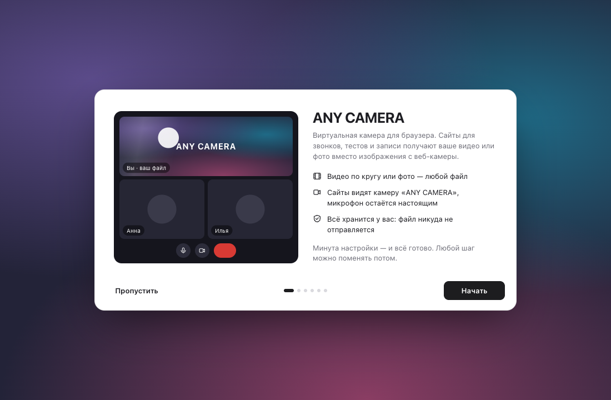

<h1 align="center">ANY CAMERA</h1>

Виртуальная камера для браузера. Сайты получают ваше видео или фото вместо изображения с веб-камеры.

<a href="https://github.com/ehroz1/any-camera-releases/releases/latest"><b>Скачать последнюю версию</b></a> · <a href="https://ehroz.pro">ehroz.pro</a>

## Установка на Mac

1. Скачайте **`ANY-CAMERA-<версия>.pkg`** из [последнего релиза](https://github.com/ehroz1/any-camera-releases/releases/latest) и откройте. Пароль администратора не нужен.
2. Откроется страница расширений Chrome, путь к папке уже скопирован: включите **«Режим разработчика»** → **«Загрузить распакованное расширение»** → <kbd>⌘</kbd><kbd>⇧</kbd><kbd>G</kbd>, <kbd>⌘</kbd><kbd>V</kbd>, <kbd>↩</kbd> → **«Выбрать»**.
3. Пройдите знакомство: выберите файл и качество.

Работает в Chrome, Яндекс Браузере, Arc, Brave и Edge. Дальше ANY CAMERA обновляется сама, а настройки сохраняются в `~/Library/Application Support/ANY CAMERA/settings.json`: даже если удалить программу и поставить снова, они подтянутся.

## Что здесь

Только готовые сборки: `.pkg` (установщик macOS), `.zip` (расширение, его ставит автообновление) и `latest.json` (лента обновлений). Кода здесь нет.

---

Сделано <a href="https://ehroz.pro"><b>ehroz.pro</b></a> · ещё от автора — Morfus, радиальный конвертер файлов для macOS

